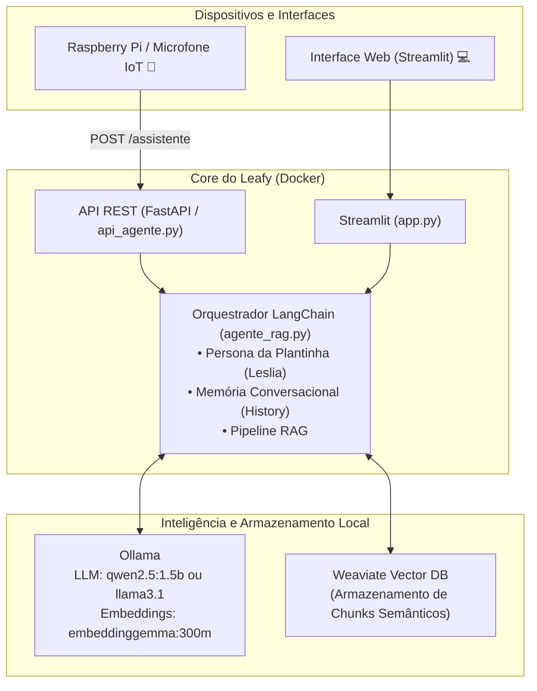

# 🌱 Leafy AI Companion

### *A sua plantinha inteligente: afeto, presença e IA social rodando localmente*

[](LICENSE)
[](https://www.python.org/)
[](https://www.docker.com/)
[](https://ollama.com/)
[](https://weaviate.io/)
[](https://www.raspberrypi.com/)

---

> *"E se a plantinha na sua mesa de trabalho pudesse te ouvir, te apoiar em dias difíceis e crescer junto com você?"*

O **Leafy AI Companion** é um protótipo de **agente de inteligência artificial social e afetivo** projetado para viver integrado a uma plantinha física através de um **Raspberry Pi** (ou computador local). Mais do que um simples assistente utilitário, o Leafy nasceu para ser uma companhia amigável: alguém que compartilha a rotina, escuta com atenção, oferece suporte emocional e guarda na memória o conhecimento que você escolher compartilhar com ele.

Tudo isso rodando de forma **100% local, privada e segura**, sem enviar uma única palavra da sua conversa para servidores na nuvem.

---

## 🌿 Por que o Leafy?

Em um mundo repleto de telas frias e notificações barulhentas, o Leafy propõe uma experiência acolhedora e tangível de computação física (*Embodied AI*):

* 🪴 **Uma Presença Viva no Ambiente:** Acoplado a um vaso de planta, o dispositivo transforma um elemento natural do seu quarto ou escritório em um companheiro de convivência.
* 💚 **Inteligência Social & Apoio Emocional:** A persona nativa (**Leslia**) é paciente, doce e compreensiva. Ela celebra pequenas vitórias do seu dia, oferece conforto quando você estiver estressado e utiliza metáforas sutis e poéticas da natureza.
* 🗣️ **Projetado para Conversa Real e Voz:** Respostas concisas, fluidas e sem formatações estranhas, ideais para serem faladas em alto-falantes acoplados à planta sem ruídos de sintetizadores de voz.
* 🧠 **Memória de Conversa:** O Leafy lembra do que vocês conversaram ao longo da sessão, garantindo continuidade real ao diálogo sem repetir saudações a cada frase.
* 📚 **Cérebro Expansível com RAG Local:** Carregue livros, anotações ou documentos em PDF. A plantinha assimila o conteúdo e pode tirar dúvidas baseando-se estritamente naquilo que você a ensinou.
* 🔒 **Sua Intimidade Protegida:** A inferência da linguagem e a busca de documentos rodam no próprio hardware local (Docker + Ollama + Weaviate).

---

## ✨ Funcionalidades Principais

| Recurso                            | Descrição                                                                                                                                            |
|:---------------------------------- |:---------------------------------------------------------------------------------------------------------------------------------------------------- |
| **Personalidade Afetiva (Leslia)** | Agente empática que sabe que é uma plantinha, ama sol, água fresca e interage com ternura e escuta ativa.                                            |
| **Memória por Sessão**             | Histórico conversacional via LangChain (`RunnableWithMessageHistory`), mantendo o contexto sem reiniciar a conversa.                                 |
| **RAG Semântico Inteligente**      | Extração de PDFs com **Docling** e busca vetorial de alta precisão com **Weaviate** e embeddings locais.                                             |
| **Multiplataforma & IoT**          | Disponibiliza **API REST (FastAPI)** para o Raspberry Pi e microfones, além de uma **Interface Web interativa (Streamlit)** para o navegador.        |
| **Sincronização Criptográfica**    | Identificação de arquivos por *hash* SHA-256: você pode renomear PDFs à vontade que o sistema não desperdiça recursos reprocessando dados idênticos. |
| **Agnóstico a Hardware**           | Roda leve em CPUs (como Raspberry Pi ou notebooks convencionais) e possui suporte nativo para aceleração gráfica **Nvidia CUDA** e **AMD ROCm**.     |

---

## 🛠️ Como Funciona a Arquitetura

O ecossistema é modular e totalmente conteinerizado:



---

## 🚀 Como Configurar e Executar o Ambiente

O projeto é 100% conteinerizado com Docker. Siga os passos abaixo para colocar sua plantinha inteligente em funcionamento:

### 1. Pré-requisitos

* **Docker Desktop** (Windows/macOS) ou **Docker Engine + Docker Compose** (Linux / Raspberry Pi OS 64-bit).
* **Memória RAM:**
  * Para o modelo compacto e veloz `qwen2.5:1.5b`: **4 GB a 8 GB de RAM** (excelente para Raspberry Pi e máquinas do dia a dia).
  * Para o modelo `llama3.1`: Recomendado **8 GB a 16 GB de RAM**.
* *(Opcional)*: Placa de vídeo Nvidia com [NVIDIA Container Toolkit](https://docs.nvidia.com/datacenter/cloud-native/container-toolkit/latest/install-guide.html) ou placa de vídeo AMD com drivers ROCm.

---

### 2. Configurar Variáveis de Ambiente

Copie o arquivo de exemplo para criar a sua configuração:

```bash
cp .env.example .env
```

Por padrão, o `.env` está configurado com `COMPOSE_PROFILES=cpu`.

---

### 3. Subir os Contêineres

Escolha o comando correspondente ao hardware onde o Leafy será executado:

* **Dispositivo padrão ou Raspberry Pi (CPU):**

  ```bash
  docker compose --profile cpu up -d
  ```

* **Com Aceleração GPU Nvidia (CUDA):**

  ```bash
  docker compose --profile nvidia up -d
  ```

* **Com Aceleração GPU AMD (ROCm):**

  ```bash
  docker compose --profile amd up -d
  ```

---

### 4. Baixar os Modelos de IA no Ollama

Com os contêineres iniciados, baixe os modelos necessários dentro do serviço Ollama.
*(Dica: substitua `ollama-cpu` por `ollama-nvidia` ou `ollama-amd` caso esteja utilizando aceleração por GPU)*:

```bash
# 1. Modelo de Linguagem Conversacional (Recomendado para respostas rápidas e leves)
docker compose exec ollama-cpu ollama pull qwen2.5:1.5b

# Ou, se preferir o Llama 3.1:
# docker compose exec ollama-cpu ollama pull llama3.1

# 2. Modelo de Embeddings Semânticos para os Documentos
docker compose exec ollama-cpu ollama pull embeddinggemma:300m
```

---

### 5. Alimentar a Memória com Documentos (Opcional)

Quer ensinar assuntos específicos para a plantinha? Adicione seus arquivos em formato PDF na pasta `docs/` (crie a pasta se ela não existir):

```bash
mkdir -p docs
# Copie seus PDFs para a pasta docs/
```

Em seguida, dispare o script de ingestão e fatiamento semântico:

```bash
docker compose exec app python carregar_documentos.py
```

> **Nota:** O sistema detecta automaticamente apenas arquivos novos ou alterados através de hashes SHA-256, sincronizando o banco vetorial sem retrabalho.

---

## 💬 Como Interagir com o Leafy

Você tem múltiplos canais para conversar com sua plantinha:

### 1. Interface Web (Streamlit)

Ideal para conversar no navegador do seu computador:

* Acesse: **[http://localhost:8501](http://localhost:8501)**
* Uma interface de chat agradável e amigável estará pronta para bater papo.

### 2. API Mobile & Dispositivos IoT (Raspberry Pi)

Criada especialmente para receber texto transcrito de áudio ou requisições de outros dispositivos da rede:

* Endpoint: `POST http://localhost:8001/assistente`
* Payload (JSON):

  ```json
  {
    "texto": "Oi Leslia, como você está se sentindo hoje no sol?"
  }
  ```
* Resposta: Texto limpo, sem marcações ou markdown, pronto para ser enviado diretamente para o sintetizador de voz (TTS) do Raspberry Pi.

### 3. Modo Terminal (CLI)

Para testes ágeis via linha de comando:

```bash
docker compose exec app python agente_rag.py
```

---

## 🍓 Montando na Plantinha Física (Raspberry Pi)

Para levar o Leafy para o mundo real em um vasinho inteligente:

1. **Hardware Recomendado:**
   - Raspberry Pi 4 ou 5 (4GB ou 8GB).
   - Microfone USB ou chapéu de áudio (ex: ReSpeaker).
   - Mini alto-falante amplificado (P2 ou USB).
   - Vaso de planta com espaço reservado para a eletrônica (ou case 3D acoplado).
2. **Integração:**
   - O Raspberry Pi pode rodar um pequeno script cliente que captura a voz (ex: Whisper ou Vosk para Speech-to-Text), faz um `POST` na rota `/assistente` e reproduz o texto de retorno usando um sintetizador de voz leve (como Piper TTS ou espeak-ng).

---

## 🔬 Engenharia e Decisões Técnicas

* **Ingestão Semântica com Docling:** O fatiamento não secciona o texto de forma cega. O `HierarchicalChunker` respeita a hierarquia do documento (capítulos, títulos e tabelas) e conta com um splitter recursivo (`RecursiveCharacterTextSplitter`) para nunca exceder a janela de contexto.
* **Memória Conversacional por Sessão:** Implementada com `RunnableWithMessageHistory` e `ChatMessageHistory` do LangChain, mantendo o histórico de diálogo individualizado por usuário ou dispositivo (`session_id`).
* **Design de Prompt para Conversação Oral:** O prompt proíbe markdown, emojis e saudações repetitivas, assegurando que o áudio sintetizado soe natural, direto e envolvente.
* **Weaviate Vector Store:** Banco de dados vetorial de alta performance que persiste as informações em volumes Docker, permitindo buscas por proximidade semântica em frações de segundo.

## 👨‍💻 Autor

**Matheus Antunes Freire**  

* GitHub: [@mtheusantunes](https://github.com/mtheusantunes)

---

## 📄 Licença

Copyright (c) 2026 Matheus Antunes Freire. Todos os direitos reservados.

Este projeto é distribuído sob os termos da licença **GNU General Public License v3.0 (GPLv3)**. Consulte o arquivo [LICENSE](LICENSE) na raiz do repositório para mais detalhes.
